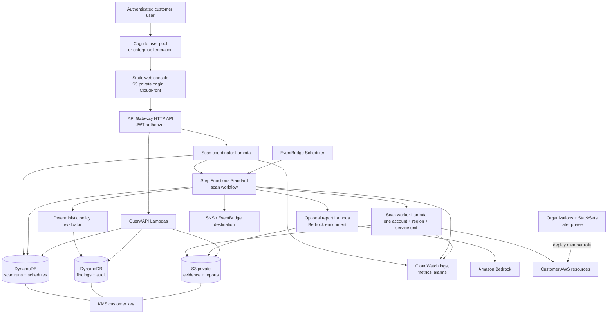
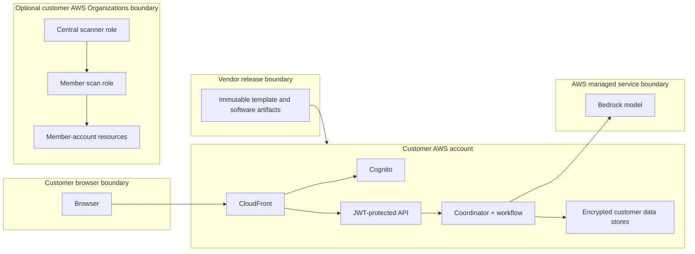
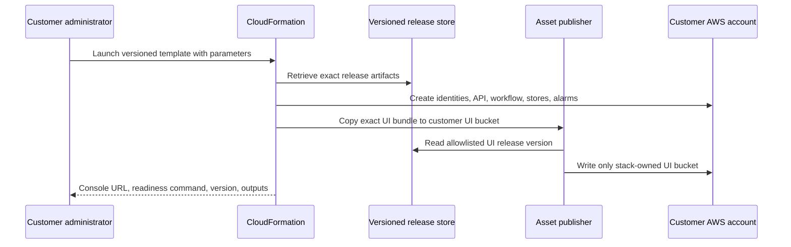
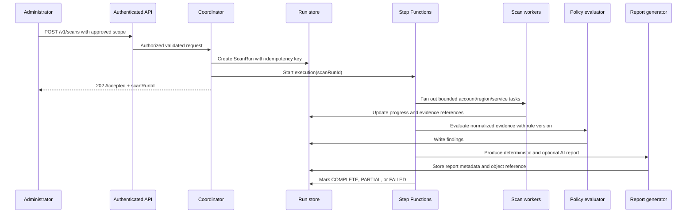

# Sovereign Shield Product Architecture

## 1. Purpose and status

This document is the target architecture for the first customer-deployable
Sovereign Shield release. It replaces the current developer-only CDK,
App Runner, and synchronous-Lambda deployment model.

Status: Phase 0 complete. This architecture and the v1 product contract were
accepted as the implementation baseline. The empirically tested
supported-region/model matrix remains a Phase 4 release gate.

## 2. Product boundary

Sovereign Shield is a customer-account-resident data-sovereignty assessment
service. It inventories selected AWS configurations, identifies cross-region
data-flow indicators, evaluates evidence against versioned policy rules, and
provides findings, reports, and remediation guidance.

The product is an assessment tool, not a legal-certification system. It must
show evidence, the rule version used, data classification assumptions, and
uncertainty so customers can validate every material conclusion.

### In scope

- A native CloudFormation deployment into the customer's commercial AWS
  account.
- One account per installation in the first deployable release.
- Optional AWS Organizations onboarding through StackSets in a later phase.
- Authenticated user access to a web console and API.
- On-demand and explicitly enabled scheduled scans.
- Customer-owned encrypted records, reports, and operational logs.
- Optional Bedrock-generated executive reports and remediation narratives.

### Out of scope for the first production release

- Automatic changes to customer infrastructure.
- Automatic SCP attachment or policy enforcement.
- Customer AWS access-key collection or credential entry in the UI.
- GovCloud, China, or any untested AWS region/partition.
- A claim of automatic legal compliance.

## 3. Architecture principles

1. **Customer account ownership.** Findings, reports, encryption keys, logs,
   schedules, and runtime identities reside in the customer's account.
2. **Secure by default.** Scheduled scans are off by default. Reports are
   private. API calls require an authenticated identity. Data is retained by
   default when the stack is removed.
3. **Deterministic evidence first.** Scanner execution and policy evaluation
   are code-driven, repeatable, versioned, and testable. Generative AI improves
   summaries; it does not decide whether a scan runs or mutate AWS resources.
4. **Asynchronous operations.** A multi-region scan is a durable workflow, not
   a long HTTP request.
5. **Least privilege.** API, workflow, scanner, report-generation, scheduler,
   and cross-account identities are distinct roles with narrowly scoped
   permissions.
6. **Release immutability.** Customer stacks reference published, versioned
   artifacts by exact version/digest. No customer must build source artifacts.
7. **Explainable results.** Every finding links to resource evidence, source
   account/region, rule version, scan time, and explicit assumptions.
8. **No silent egress.** The customer can see and control what is sent to
   Bedrock. A no-LLM reporting mode remains fully usable.

## 4. Target component view

## 5. Component responsibilities

| Component | Responsibility | State or authority |
|---|---|---|
| CloudFormation central stack | Creates all customer-account resources, conditions, tags, outputs, and lifecycle policies. | No scan begins during installation. |
| Release artifact distribution | Provides exact-version Lambda packages, static UI bundle, templates, checksums, and SBOM. | Vendor-owned, read-only release source; no customer data stored. |
| Asset publisher custom resource | Copies the signed/versioned UI bundle from the release source to the customer UI bucket during deployment or upgrade. | Writes only to the stack-owned UI bucket. |
| CloudFront + private UI bucket | Serves the browser console through origin access control and secure response headers. | Static code only; no reports or findings. |
| Cognito / federation | Authenticates users and emits JWTs with customer-managed group membership. | Administrators and auditors are distinct groups. |
| API Gateway HTTP API | Enforces JWT authentication, throttling, request-size limits, CORS, access logs, and routing. | No unauthenticated data APIs. |
| Scan coordinator Lambda | Validates a request, checks authorization and scan guardrails, creates an idempotent run, and starts the state machine. | May create runs only; cannot alter scanned resources. |
| Step Functions Standard | Coordinates validation, fan-out, retry, aggregation, rule evaluation, reporting, notification, and terminal run status. | Durable scan state; no direct browser dependency. |
| Scan worker Lambda | Performs bounded discovery for one account, region, and service. Normalizes evidence and errors. | Read-only AWS APIs and optional approved `AssumeRole`. |
| Policy evaluator Lambda | Converts evidence into findings using versioned deterministic rules. | No Bedrock requirement and no AWS mutation authority. |
| Report generator Lambda | Produces report artifacts and optional Bedrock narrative from structured findings. | Can write reports only; must not receive unnecessary raw data. |
| DynamoDB run/schedule table | Stores run request, state transitions, progress counters, idempotency keys, and schedule definitions. | Encrypted and point-in-time recoverable. |
| DynamoDB findings/audit table | Stores findings, evaluation metadata, remediation state, and audit events. | Encrypted; indexed for server-side filtering. |
| Private S3 reports/evidence bucket | Stores evidence payloads, report files, and optional exports. | Versioned, private, lifecycle-managed, customer-key encrypted. |
| EventBridge Scheduler | Starts explicitly created schedules with a versioned scan request. | Cannot invoke raw scanner functions directly. |
| SNS or EventBridge target | Delivers concise failure/critical-finding notifications. | Detailed data remains in the console/report store. |
| CloudWatch | Provides logs, metrics, alarms, dashboards, and operational correlation IDs. | Logs are redacted and retention-configurable. |
| Organizations + StackSets | Deploys a least-privilege member role to selected customer accounts/OUs. | Later phase only; no vendor account trust is required. |

## 6. Trust boundaries and identities

### 6.1 User identities

- **Administrator:** starts scans, manages schedules, settings, notifications,
  account onboarding, and report access.
- **Auditor:** views scan runs, findings, evidence metadata, reports, and
  remediation guidance; cannot change schedules or account configuration.
- **Read-only API access:** not enabled in the first release unless it is
  explicitly tied to a Cognito group and documented.

The API verifies a Cognito JWT and then authorizes each operation in the
application service layer. Browser-supplied group claims alone are not treated
as permission to access a different customer deployment.

### 6.2 Runtime identities

| Role | Required authority | Explicitly prohibited |
|---|---|---|
| API/coordinator | Create run records, start approved workflows, read safe configuration. | AWS resource scanning or mutation. |
| Workflow | Invoke bounded workers/evaluator/reporter and update run state. | Browser access and direct resource mutation. |
| Scan worker | Read-only service discovery in current account or approved member scan role. | Write, delete, update, policy attachment, or SCP management. |
| Policy evaluator | Read evidence and write findings. | Bedrock invocation and direct AWS discovery. |
| Report generator | Read structured findings, invoke Bedrock when enabled, write report objects. | Resource discovery, schedule management, and remediation actions. |
| Scheduler | Start a named state machine with a stored schedule payload. | Invoke individual worker Lambdas. |
| Asset publisher | Read a fixed release object/version and write a stack-owned UI asset bucket. | Read reports or findings. |
| Member scan role | Scoped read-only access to supported service inventory APIs. | Assume arbitrary roles or alter customer resources. |

## 7. Data model and classification

### 7.1 Core records

`ScanRun` records include:

- `scanRunId`, idempotency key, requester identity, request timestamp, status,
  scan scope, selected rule-set version, report mode, progress counters, and
  terminal error summary;
- requested accounts, regions, services, regulations, and schedule ID when
  relevant;
- links to report and evidence object prefixes, not embedded unbounded payloads.

`Finding` records include:

- finding ID, scan run ID, account ID, region, service, resource ARN/name,
  evidence ID, rule ID/version, severity, confidence/uncertainty, data category
  assumption, created timestamp, and remediation status;
- an evidence digest so later reports can prove what was evaluated.

`Schedule` records include:

- schedule ID, authenticated creator, enabled status, schedule expression,
  immutable scan-request version, target scope, notification preference, and
  EventBridge Scheduler ARN.

`AuditEvent` records include:

- actor, action, target ID, timestamp, outcome, request correlation ID, and
  redacted relevant metadata.

### 7.2 Data categories

| Category | Example | Storage/control |
|---|---|---|
| Customer resource metadata | ARN, resource name, region, encryption setting, replication configuration | Customer DynamoDB/S3, encrypted. |
| Potentially sensitive identifiers | Bucket/table/function names, tags, endpoint fragments | Minimize, redact from logs, include in Bedrock only when report mode permits it. |
| Compliance evidence | API response fragments required to justify finding | Private S3, versioned, lifecycle-managed. |
| Derived findings/reports | Severity, rule outcome, summary, remediation guidance | Customer DynamoDB/S3, encrypted. |
| User identity/audit data | Cognito subject, group, timestamp, action | Minimal collection; encrypted DynamoDB/logs. |
| Product release data | Template, binaries, checksums, SBOM | Vendor release store; must never contain customer data. |

### 7.3 Encryption and retention

- Use a customer-managed KMS key by default for findings, reports, evidence,
  and application logs where the AWS service supports it. Allow an explicitly
  selected existing customer key.
- Enable DynamoDB point-in-time recovery.
- Use S3 versioning, block public access, bucket-owner-enforced ownership,
  lifecycle expiration, and explicit deletion behavior.
- Make findings, reports, and log retention template parameters with safe,
  documented bounds.
- Default stack deletion to retaining customer data. A non-production delete
  path requires explicit acknowledgement.

## 8. Primary data flows

### 8.1 Release and deployment flow

The template must reference immutable artifact versions. The release manifest
maps each supported stack region to its artifact locations and checksums. No
deployment package is built on the customer workstation.

### 8.2 Authentication and console flow

1. The customer opens the CloudFront console URL.
2. The console redirects to Cognito hosted UI or approved enterprise federation.
3. Cognito returns an authorization-code-with-PKCE result; the console receives
   short-lived tokens.
4. The console sends the JWT to API Gateway.
5. API Gateway validates issuer, audience, expiration, and signature.
6. The service layer checks group/role authorization for the requested action.
7. API responses contain only the authorized deployment's records.

The UI bucket contains no customer findings. It can remain publicly reachable
only through CloudFront if it contains generic static assets; all customer data
requires JWT-protected API access.

### 8.3 On-demand scan flow

The UI polls `GET /v1/scans/{scanRunId}`. It never waits for a scan response
over a long-running HTTP connection.

### 8.4 Discovery and evidence flow

1. The workflow resolves the permitted target-account list and region list.
2. It fans out a bounded worker for each selected account/region/service.
3. The worker uses only required read APIs for S3, RDS, DynamoDB, CloudFront,
   KMS, SNS/SQS, Transit Gateway, and Lambda@Edge.
4. A worker normalizes API output to typed resource and flow evidence.
5. It writes a compact evidence record or S3 evidence object and progress/error
   record. Access-denied and unsupported-service errors are preserved as scan
   coverage gaps.
6. The evaluator reads normalized evidence and produces reproducible findings.
7. The report service uses findings and approved evidence summaries, rather
   than raw arbitrary AWS API text, for optional Bedrock enhancement.

### 8.5 Optional Bedrock reporting flow

Bedrock is used only after deterministic findings are available.

1. The report worker checks whether the scan request permits generative
   reporting.
2. It builds a constrained prompt from structured finding fields, evidence
   summaries, and rule versions.
3. Resource metadata is treated as untrusted quoted data; prompts never grant
   the model permission to call tools or change infrastructure.
4. The worker records model ID, region, prompt-template version, and
   generation timestamp with the report.
5. If Bedrock is unavailable, the worker produces a deterministic report
   shell from findings and marks AI enrichment unavailable.

The customer documentation must state the exact data fields that can be sent
to Bedrock and offer a no-LLM report mode.

### 8.6 Scheduled scan flow

1. An administrator creates or updates a schedule through the authenticated API.
2. The coordinator validates the expression, scope limits, and notification
   settings; it writes an immutable request version to the schedule record.
3. EventBridge Scheduler starts the named Step Functions workflow using that
   request version.
4. The workflow creates a normal `ScanRun` and follows the on-demand flow.
5. On completion or failure, it emits metrics and sends a concise configured
   notification.

### 8.7 Organizations flow

1. A management/delegated-admin customer launches the central stack in
   organization mode.
2. The customer selects OUs/accounts; exclusions and account tags are applied.
3. A StackSet deploys the member scan role to those accounts.
4. The central scanner assumes only approved member-role ARNs using an exact
   central-role trust relationship and optional per-installation external ID.
5. Discovery results are written only to the central deployment's customer-owned
   stores.
6. Account onboarding and failure status are visible in the console.

## 9. Network posture

### Default mode

The default mode avoids customer VPC complexity:

- Lambda uses AWS-managed networking to call AWS service endpoints and Bedrock.
- The browser reaches CloudFront and API Gateway over HTTPS.
- API Gateway and CloudFront are public endpoints protected by JWT
  authorization, throttling, WAF where enabled, and strict CORS.
- Customer data stores have no public network path.

### Private-enterprise mode

Private networking is a later deployment mode because it requires explicit
customer choices and endpoint cost visibility.

- Require customer-provided VPC/subnets/security groups.
- Add interface or gateway endpoints for required AWS APIs.
- Define and test DNS, egress, Bedrock endpoint, log delivery, and cross-region
  service behavior.
- Do not treat private mode as supported until a full acceptance matrix passes.

## 10. CloudFormation resource model

The central template creates these resource groups:

| Group | Resources | Conditional behavior |
|---|---|---|
| Identity | Cognito user pool, app client, groups, JWT authorizer | Local Cognito in initial release; federation later. |
| UI | Private S3 asset bucket, CloudFront, origin access control, asset publisher | Always created when web console is enabled. |
| API | HTTP API, stages, routes, access logs, permissions, WAF association | Always authenticated; no wildcard CORS. |
| Compute | Coordinator, worker, evaluator, reporter functions and roles | Report worker enabled only when AI reporting is enabled. |
| Orchestration | Step Functions state machine, scheduler group, scheduler role | Default schedule only when explicitly enabled. |
| Data | Runs/schedules table, findings/audit table, reports/evidence bucket | KMS key mode and retention are parameterized. |
| Operations | Log groups, dashboard, alarms, notification topic | Email subscription only when supplied. |
| Organizations | StackSet, administration/execution roles, member template | Only in organization mode. |

Use a `DeploymentPrefix` plus account and region in physical names to avoid
collisions. Preserve stable CloudFormation logical IDs across compatible
upgrades. Apply `Application=SovereignShield`, deployment prefix, release
version, environment, owner, and cost-center tags to every supported resource.

## 11. API contract

| Route | Caller | Function |
|---|---|---|
| `POST /v1/scans` | Administrator | Starts validated asynchronous scan; returns `202` and `scanRunId`. |
| `GET /v1/scans/{id}` | Administrator, auditor | Returns status, progress, timestamps, and authorized links. |
| `GET /v1/scans/{id}/findings` | Administrator, auditor | Returns paginated/filterable structured findings. |
| `GET /v1/scans/{id}/report` | Administrator, auditor | Returns metadata and authorized report URL. |
| `POST /v1/schedules` | Administrator | Creates validated schedule. |
| `PATCH /v1/schedules/{id}` | Administrator | Updates/enables/disables schedule. |
| `DELETE /v1/schedules/{id}` | Administrator | Removes a schedule. |
| `GET /v1/configuration` | Administrator, auditor | Returns safe configuration and supported scan choices. |
| `GET /v1/health` | Authenticated caller | Returns release version and dependency readiness without sensitive data. |

Every mutation accepts an idempotency key, records an audit event, validates
request size/shape, rejects unknown fields where practical, and returns a
correlation ID. Do not implement free-form agent prompt routes in the initial
customer API.

## 12. Failure handling and operational behavior

### Scan status

Use explicit terminal and nonterminal statuses:

`QUEUED`, `VALIDATING`, `RUNNING`, `EVALUATING`, `REPORTING`, `COMPLETE`,
`PARTIAL`, `FAILED`, `CANCEL_REQUESTED`, and `CANCELLED`.

Partial means that at least one selected scope element was unavailable or
denied but usable findings were produced. Every run must list coverage gaps so
an apparent clean report cannot hide failed discovery.

### Retry and idempotency

- Retry throttling and clearly transient AWS service failures with exponential
  backoff and bounded attempts.
- Do not blindly retry access-denied, malformed request, unsupported region, or
  rule-evaluation defects.
- Use execution and worker idempotency keys so a retry cannot duplicate
  findings or notifications.
- Send terminal workflow errors to a dead-letter or failure-processing path
  with the scan-run correlation ID.

### Metrics and alarms

Create dashboard widgets and alarms for failed/timed-out workflows, Lambda
errors/throttles/duration, API 4xx/5xx, authorization failures, schedule
delivery failure, Bedrock errors/throttling, report failure, DynamoDB
throttling, storage growth, and notification delivery failure.

## 13. Release and upgrade design

### Release artifacts

Each release contains:

- central CloudFormation template;
- member-role StackSet template;
- Lambda packages or images with pinned dependencies;
- static UI bundle;
- per-region artifact mapping;
- SHA-256 checksums, SBOM, license report, version, commit, and release notes.

Artifacts are immutable and version-addressed. Release construction uses locked
dependencies and clean build environments. The customer deployment never
contains source-build tools.

### Upgrade

1. The release guide identifies supported upgrade paths and breaking changes.
2. The customer reviews a CloudFormation change set.
3. The stack updates versioned runtime/UI artifacts and schema-compatible
   components.
4. A post-update health check verifies authenticated API access, workflow
   readiness, and preserved data.
5. A failed update rolls back infrastructure without deleting retained reports,
   findings, or audit records.

Schema changes require an explicit migration step, progress tracking, rollback
behavior, and compatibility tests from the oldest supported version.

## 14. Implementation mapping from the current repository

| Current area | Required evolution |
|---|---|
| `cdk/stacks/sovereign_shield_stack.py` | Refactor into parameterized, condition-aware, customer-neutral infrastructure; synthesize a customer template with published assets rather than local CDK assets. |
| `scripts/build_lambda.py` | Replace ad hoc local packaging with reproducible locked dependency builds and release publishing. |
| `cdk/stacks/member_role.py` | Done (Phase 5): single source for the StackSet member-role template and the `sovereign-shield-member-role.yaml` artifact; trusts the exact central roles with the installation's external ID. The manual `scripts/cross_account_role.yaml` was removed. |
| `lambda_handler.py` | Split into coordinator/query API handlers and asynchronous workflow workers; remove synchronous complete scan behavior. |
| `tools/aws_scanner.py` | Preserve service-specific discovery but return typed normalized evidence; enforce target allowlists and correct `AssumeRole` external-ID use. |
| `tools/violation_detector.py` | Become a versioned deterministic policy evaluator with explicit assumptions/evidence. |
| `agents/*` | Restrict to optional narrative/reporting; do not make agent behavior part of scan correctness or workflow control. |
| `ui/*` | Replace session-state-only Streamlit control plane with an authenticated static console backed by durable APIs. |
| `tests/*` | Add unit, contract, IAM, CloudFormation, organization, upgrade, and full deployment acceptance suites. |

## 15. Architecture acceptance criteria

Phase 0 architecture is accepted when:

1. product, security, and platform owners approve this component/data-flow
   design;
2. a supported commercial-region and Bedrock-model matrix is published;
3. the CloudFormation parameter/output contract is approved;
4. customer data sent to Bedrock is explicitly documented and no-LLM operation
   is accepted;
5. the installer and runtime IAM boundaries are reviewed;
6. the single-account experience is agreed as the first production slice;
7. all later implementation work traces to a component or flow in this
   document.
